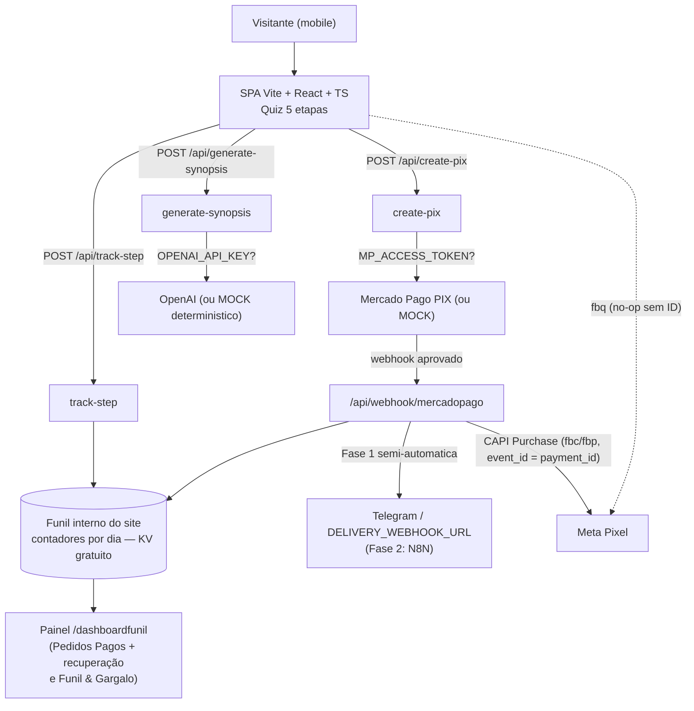

# Crie Sua História — Quiz-Funil (SPA + Serverless)

Livro infantil digital personalizado: o próprio quiz é a landing page, o configurador e o checkout transparente.

- **Ticket:** R$ 37,90 (de R$ 79,90) — PDF ilustrado de alta resolução, 6 páginas
- **Order bumps:** Livro de Colorir PDF **+R$ 9,90** · Narração em Áudio **+R$ 12,90** (envio em até 24h)

## Arquitetura



```
  [Quiz SPA] --track-step--> [Funil interno: contadores por dia]  (abandono por etapa, so Meta pago + bio)
             --synopsis----> [OpenAI | mock]
             --create-pix--> [Mercado Pago | mock PIX] + [Pedido guardado c/ UTMs]
             <--webhook------ [MP] --approved--> [Funil interno: compra] + [Telegram/Webhook -> producao manual -> e-mail]
                                                + [Meta CAPI: Purchase c/ fbc/fbp]
  [Painel /dashboardfunil] --le (ADMIN_USER+ADMIN_PASSWORD ou ADMIN_KEY)--> [Funil interno + pedidos]  (sem custo, sem banco externo)
```

## Captura de UTMs e atribuição (`lead_tracking`)

1. **Captura (front):** na abertura do quiz, `src/lib/tracking.ts` lê da URL `utm_source`, `utm_medium`, `utm_campaign`, `utm_content`, `utm_term`, `fbclid` e `gclid`, soma os cookies `_fbp`/`_fbc` do Pixel (o `fbc` é derivado do `fbclid` quando o cookie não existe) e salva tudo em `localStorage` na chave **`lead_tracking`** — *first-touch*: só sobrescreve se ainda não havia nada guardado ou se a URL nova trouxer `fbclid`/`gclid`.
2. **Persistência no funil:** esse objeto viaja em **todas** as chamadas de `/api/track-step` e `/api/create-pix` (campo `tracking`).
3. **Classificação de origem** (idêntica no front e no servidor — o servidor recalcula e não confia no campo `origin` do cliente):
   - `meta-ads`: tem `fbclid`, ou `utm_source` ∈ {meta, facebook, fb, instagram} **e** `utm_medium` ∈ {cpc, paid, pago, ads, anuncio};
   - `bio`: `utm_medium = bio` ou `utm_source = bio`;
   - `outro`: todo o resto.
4. **Escopo do painel:** o `/dashboardfunil` **só** acompanha `meta-ads` e `bio`. Os contadores por dia (em `server/trackStore.ts`) guardam totais + recorte `origins` + recorte `campaigns` (por `utm_campaign`) — visitas `outro` não entram em nenhum agregado. Modelos de UTM para usar sempre:
   - Anúncio Meta: `?utm_source=meta&utm_medium=cpc&utm_campaign=NOME-DA-CAMPANHA` (o `fbclid` a Meta acrescenta sozinha);
   - Bio: `?utm_source=instagram&utm_medium=bio&utm_campaign=bio`.
5. **Pedidos (orders):** ao criar o PIX, `create-pix` guarda o pedido **completo** ligado ao `payment_id` (`saveOrder`: valor, comprador com WhatsApp, dados do livro — criança/idade/gênero/estilo/aventura/moral/dedicatória —, sinopse aprovada, bumps, `tracking`, origem e campanha, status `pendente`; é o equivalente, no nosso armazenamento próprio, às colunas de UTM da sessão/pedido). A **foto da criança** é reduzida no navegador (máx. 900px, JPEG) e guardada à parte (`savePhoto`): no KV (`photo:<payment_id>`) ou na pasta privada `.data/uploads/` em dev — nunca pública; o painel a lê via `GET /api/admin-photo` autenticado. No webhook de pagamento aprovado, o pedido é marcado `pago` (com `paid_at`) por merge pelo `payment_id`, a venda é atribuída à origem/campanha certa, o aviso de entrega ganha resumo do pedido + foto (link `${PUBLIC_BASE_URL}/api/admin-photo?payment_id=...` quando `PUBLIC_BASE_URL` está definida; o link exige o login do painel no navegador) e o **Purchase da Conversions API** (`server/metaCapi.ts`) é disparado com `event_id = payment_id` (mesmo id do `Purchase` do Pixel, que deduplica), `user_data.em` em SHA-256 e `fbc`/`fbp` quando existirem.

## Painel `/dashboardfunil` — Pedidos, recuperação e funil

Rota oculta (nenhum link na página; a página toda tem `noindex, nofollow`). Login por **usuário + senha** (`ADMIN_USER`/`ADMIN_PASSWORD`, headers `x-admin-user`/`x-admin-password`) ou pela **chave única** `ADMIN_KEY` (header `x-admin-key`, fallback). Sem nenhuma das duas configurações, os endpoints `/api/admin-*` respondem **503**.

- **Aba 1 — Pedidos Pagos (padrão):** fila de despacho vinda de `GET /api/admin-orders?status=pago` — data/hora, comprador (nome/e-mail/WhatsApp), dados do livro, sinopse aprovada (recolhível), miniatura da foto com abrir/baixar, badges dos bumps (`Livro de Colorir em PDF (+ R$ 9,90)`, `Narração em Áudio (+ R$ 12,90)`), total pago, origem/UTMs e o **toggle Pendente → Enviado** (`POST /api/admin-orders`).
- **Recuperação — sub-filtro “Geraram PIX e não pagaram”:** `GET /api/admin-orders?status=pendente` lista quem preencheu o checkout e gerou o PIX, mas não pagou — com nome, e-mail, WhatsApp (botão direto para `wa.me`), criança/aventura, total, bumps, origem e foto. Os dados vêm **do formulário do checkout, coletados na geração do PIX**. Quem abandona **antes** de gerar o PIX (ou antes do checkout) não deixou dado pessoal nenhum — aparece **apenas** como contagem agregada no funil, sem identificação. Quando o pagamento é aprovado, o webhook move o mesmo registro (merge por `payment_id`) da lista de recuperação para a fila de pagos.
- **Aba 2 — Funil & Gargalo:** os contadores já descritos (etapas, compras, receita, ticket), mais **Pix Gerados × Pix Pagos** (`pixGenerated` por dia/origem/campanha, incrementado a cada `create-pix` com sucesso, real ou mock), gargalo principal e sugestões.

**Persistência (honesto):** em produção, pedidos e fotos ficam no **KV** (binding `TRACK_KV`) — é isso que garante que nada se perde em reinicializações. Localmente, ficam em `.data/orders.json` + `.data/uploads/` (pasta persistente e privada, fora do Git). **Sem** o binding KV, um deploy serverless cai para arquivo/memória do processo, que é **efêmero** — serve para testar, não para guardar pedidos de produção.

## Árvore de arquivos

```
crie-sua-historia/
├── index.html                  # PT-BR, fontes, noindex/nofollow, placeholder do Meta Pixel
├── package.json / tsconfig.json / vite.config.ts
├── tsconfig.functions.json     # Type-check so do adaptador Pages (functions/ + api/ + server/)
├── wrangler.jsonc              # Cloudflare Pages: nome, nodejs_compat, saida dist (KV vai pelo painel)
├── functions/
│   └── api/[[path]].ts         # Adaptador Pages Functions: monta req/res, faz a ponte de env e roteia p/ api/*
├── .env.example                # TODAS as variaveis (copie para .env)
├── ARQUITETURA.md              # Resumo amigavel da arquitetura (PT)
├── api/                        # Serverless functions (padrao Vercel)
│   ├── generate-synopsis.ts    # POST /api/generate-synopsis
│   ├── create-pix.ts           # POST /api/create-pix
│   ├── track-step.ts           # POST /api/track-step (contadores do funil)
│   ├── admin-stats.ts          # GET /api/admin-stats (contadores; auth usuario/senha ou ADMIN_KEY)
│   ├── admin-orders.ts         # GET/POST /api/admin-orders (fila de pagos, recuperacao, toggle Enviado)
│   ├── admin-photo.ts          # GET /api/admin-photo (foto do pedido, autenticada, nunca publica)
│   └── webhook/mercadopago.ts  # POST /api/webhook/mercadopago
├── server/                     # Lib compartilhada das functions
│   ├── http.ts                 # Tipos minimos req/res (sem @vercel/node)
│   ├── adminAuth.ts            # Auth do painel: ADMIN_USER/ADMIN_PASSWORD ou ADMIN_KEY (fallback)
│   ├── synopsis.ts             # OpenAI + mock deterministico {title, summary, chapters[]}
│   ├── tracking.ts             # Espelho server-side: sanitize + classificacao de origem (meta-ads/bio/outro)
│   ├── trackStore.ts           # Funil interno: contadores por dia c/ origins+campaigns+pixGenerated, pedidos completos (orders) e fotos (KV / .data/uploads)
│   ├── metaCapi.ts             # Meta Conversions API: Purchase server-side com fbc/fbp
│   └── notify.ts               # Telegram / webhook de entrega (fase 1, com bloco de UTMs)
└── src/
    ├── main.tsx / App.tsx      # Estado do quiz, sessao, pixel e tracking
    ├── types.ts                # Tipos, precos, estilos, aventuras, morais
    ├── styles.css              # CSS proprio, paleta infantil suave, mobile-first
    ├── lib/
    │   ├── pixel.ts            # fbq safe no-op + ViewContent/Lead/InitiateCheckout/Purchase (Purchase c/ eventID)
    │   ├── tracking.ts         # Captura de UTMs (lead_tracking), cookies _fbp/_fbc e classificacao de origem
    │   ├── track.ts            # track-step fire-and-forget c/ tracking (+ eventos locais p/ o painel no preview)
    │   └── mockSynopsis.ts     # Fallback client-side: sinopse e PIX mock locais
    └── components/
        ├── ProgressBar.tsx     # 1 Foto -> 2 Visual -> 3 Aventura -> 4 Revisao -> 5 Pagamento
        ├── Step1Photo.tsx      # Nome*, idade 1-10, genero, upload drag-and-drop + preview, "enviar depois"
        ├── Step2Style.tsx      # 4 cards visuais de estilo + "6 Paginas (Incluido no plano)"
        ├── Step3Adventure.tsx  # Aventura, moral, dedicatoria
        ├── Step4Review.tsx     # Loading IA, sinopse, micro-chat de refinamento
        ├── Step5Checkout.tsx   # Resumo, bumps c/ total ao vivo, comprador, so PIX (cartao removido nesta fase), timer 15min
        └── AdminPanel.tsx      # Painel /dashboardfunil: aba Pedidos Pagos (+ recuperacao) e aba Funil & Gargalo
```

## Rodar localmente

```bash
npm install
npm run dev        # http://localhost:5173 — front com fallbacks MOCK (sinopse + PIX)
npm run build      # typecheck + build de producao (dist/)
npm run preview
# Para rodar as functions /api de verdade no seu ambiente:
npx vercel dev     # (opcional) expoe /api/* junto do front
```

Sem nenhuma chave, o app **funciona por completo em modo demonstração**: sinopse gerada pelo mock, PIX mock claramente identificado, tracking apenas no console/painel local — e lembrando que o funil só registra as visitas das origens rastreadas (anúncio Meta pago e bio, ver seção de UTMs).

## Variáveis de ambiente

| Variável | Onde | Para quê | Sem ela |
|---|---|---|---|
| `VITE_META_PIXEL_ID` | Front | Meta Pixel | Pixel vira no-op |
| `META_PIXEL_ID` | Server | ID do Pixel para a Conversions API (webhook) | Purchase server-side só loga |
| `META_CAPI_ACCESS_TOKEN` | Server | Token da Conversions API (Gerenciador de Eventos) | Purchase server-side só loga |
| `OPENAI_API_KEY` | Server | Sinopse com IA real | Mock determinístico |
| `OPENAI_MODEL` | Server | Modelo (default `gpt-4o-mini`) | Usa o default |
| `MP_ACCESS_TOKEN` | Server | PIX real no Mercado Pago | PIX MOCK marcado |
| `MP_WEBHOOK_SECRET` | Server | Verificar assinatura do webhook MP | Webhook aceita sem verificar |
| `ADMIN_USER` + `ADMIN_PASSWORD` | Server | Login principal do painel `/dashboardfunil` (só a Caroline sabe) | Sem login configurado (nem ADMIN_KEY), o painel responde 503 |
| `ADMIN_KEY` | Server | Chave única do painel (fallback do login acima) | Login por usuário/senha continua valendo |
| `PUBLIC_BASE_URL` | Server | URL pública do site p/ o link da foto no aviso do Telegram | Aviso diz que a foto está no painel |
| `TRACK_KV` (binding) | Server (deploy) | Onde os contadores do funil ficam guardados (KV gratuito da Cloudflare) | Arquivo local (dev) ou memória |
| `TELEGRAM_BOT_TOKEN` | Server | Aviso de pedido pago | — |
| `TELEGRAM_CHAT_ID` | Server | Destino do aviso Telegram | — |
| `DELIVERY_WEBHOOK_URL` | Server | Alternativa ao Telegram (ex.: N8N) | Aviso só no log |

Copie `.env.example` para `.env` (local) e replique as variáveis no painel da hospedagem. **Nunca** coloque chaves de servidor com prefixo `VITE_`.

## Publicação (Cloudflare Pages) — caminho oficial

O site roda na **Cloudflare Pages** (mesmo esquema das cifras): repositório no GitHub conectado à Cloudflare, com deploy automático a cada push. As functions de `api/` NÃO mudam: o adaptador `functions/api/[[path]].ts` recebe tudo que é `/api/*`, traduz Fetch ⇄ req/res, copia as variáveis de `context.env` para `process.env` (e o binding do KV para `globalThis.TRACK_KV`) e chama o handler certo. O `wrangler.jsonc` já vem pronto (nome `crie-sua-historia`, flag `nodejs_compat`, saída `dist`).

**Passo a passo no painel da Cloudflare (uma vez só):**

1. **Criar o projeto:** Cloudflare → **Workers & Pages** → **Create** → aba **Pages** → **Connect to Git** → escolha o repositório **Crie-Sua-Historia**. Configuração de build: comando `npm run build`, diretório de saída `dist`. Salve e aguarde o primeiro deploy (o endereço fica parecido com `crie-sua-historia.pages.dev`).
2. **Ligar o KV (funil, pedidos e fotos):** no projeto → **Settings → Functions → KV namespace bindings** → crie um namespace novo chamado `crie-sua-historia-track` e ligue com o nome de variável/binding **`TRACK_KV`** (ambiente **Production**). Sem isso, contadores **e pedidos/fotos** caem para memória/arquivo efêmero do serverless — serve para testar, não para vender.
3. **Variáveis de ambiente (Production):** no projeto → **Settings → Environment variables** → adicione:
   - `OPENAI_API_KEY` — sinopse com IA de verdade
   - `MP_ACCESS_TOKEN` e `MP_WEBHOOK_SECRET` — PIX real no Mercado Pago
   - `ADMIN_USER` e `ADMIN_PASSWORD` — login do painel `/dashboardfunil` (ou, como alternativa, `ADMIN_KEY`)
   - `PUBLIC_BASE_URL` — `https://crie-sua-historia.pages.dev` (ajuste para o endereço/domínio final depois do primeiro deploy)
   - `TELEGRAM_BOT_TOKEN` + `TELEGRAM_CHAT_ID` **ou** `DELIVERY_WEBHOOK_URL` — aviso de pedido pago (entrega fase 1)
   - `META_PIXEL_ID` + `META_CAPI_ACCESS_TOKEN` — Purchase server-side (Conversions API); e `VITE_META_PIXEL_ID` — Pixel no navegador
4. **Republicar:** depois de salvar KV e variáveis, vá em **Deployments** → menu do deploy mais recente → **Retry deployment** (as variáveis/binding só valem a partir de um deploy novo).
5. **Webhook do Mercado Pago:** no painel do Mercado Pago (Suas integrações → Webhooks), cadastre a URL `https://SEU-DOMINIO/api/webhook/mercadopago` (troque `SEU-DOMINIO` pelo endereço final do site).

> Alternativa (não recomendada): na Vercel as pastas `api/` e `server/` viram functions automaticamente, mas lá NÃO existe o binding `TRACK_KV` — o painel `/dashboardfunil` não guardaria os dados de produção de forma confiável. Por isso o caminho oficial é a Cloudflare.

## MOCK vs REAL

| Recurso | MOCK (sem chave) | REAL (com chave) |
|---|---|---|
| Sinopse | Template determinístico com nome/tema/moral; o ajuste do micro-chat entra visivelmente em um capítulo | OpenAI retorna `{title, summary, chapters[6]}` |
| PIX | `mock: true`, QR em SVG escrito "PIX MOCK", copia-e-cola falso, botão "Simular pagamento aprovado" | Cobrança PIX real (QR base64 + copia-e-cola + expiração do MP) |
| Funil interno / painel | Eventos e pedidos locais desta sessão no navegador (banner avisa que é demonstração local) — o Pix mock já cria pedido pendente e o “simular aprovado” move o mesmo pedido para a fila de pagos | Contadores agregados por dia no KV (totais + `origins` + `campaigns` + `pixGenerated`); painel `/dashboardfunil` com aba **Pedidos Pagos** (fila de despacho + recuperação dos pendentes) e aba **Funil & Gargalo** — **só anúncio Meta pago + bio** |
| Pedidos e fotos | Arquivo local `.data/orders.json` + fotos em `.data/uploads/` (persistente em dev) | KV (`order:`/`photo:`/`orders:index`) — persistente no deploy; sem o binding, o arquivo de um serverless é efêmero |
| Notificação | Log no servidor | Telegram ou `DELIVERY_WEBHOOK_URL` (com resumo do pedido, link da foto e o bloco de UTMs da venda) |
| Cartão | **Removido nesta fase** — checkout só com PIX por enquanto; volta depois | Tokenização via SDK JS do Mercado Pago (plugar o token no backend) |
| `Purchase` (Pixel + CAPI) | Pixel dispara no sucesso do front com `eventID = payment_id` (sinal imediato/teste) | **Oficial: webhook** dispara o mesmo `Purchase` pela Conversions API, mesmo `event_id`, com `fbc`/`fbp` e e-mail em hash — a Meta deduplica os dois |

## Fase 2 — N8N
O webhook de pagamento aprovado já entrega um payload estruturado (sessão, comprador, respostas do quiz) para `DELIVERY_WEBHOOK_URL`. Na fase 2, basta apontar essa URL para um workflow N8N que gere as ilustrações/PDF e envie o e-mail automaticamente, substituindo o despacho manual da fase 1.
